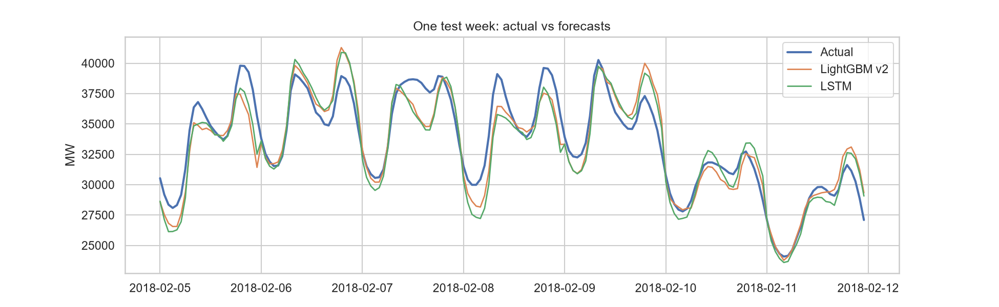
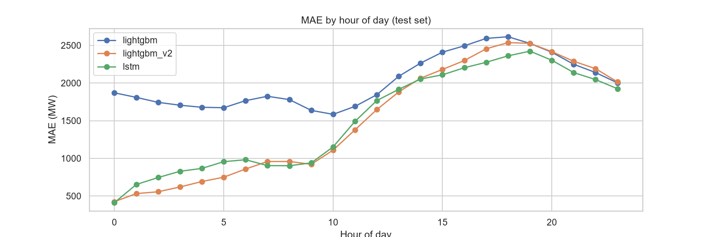

# Day-Ahead Electricity Load Forecasting (PJM East)

Forecasting hourly electricity demand for the next day using statistical analysis, gradient boosting and an LSTM, evaluated on a strict time-based split.

## Results
Test period: 1 Jan to 3 Aug 2018 (5,136 hours). All models forecast the next 24 hours from data known at midnight.

| Model | MAE (MW) | RMSE (MW) | MAPE |
|---|---|---|---|
| Ensemble (LightGBM + LSTM) | 1,467 | 2,113 | 4.40% |
| LightGBM | 1,511 | 2,181 | 4.52% |
| LSTM | 1,515 | 2,145 | 4.59% |
| Naive (same hour yesterday) | 2,531 | 3,397 | 7.91% |




## Key findings
- Data: PJM East hourly load, 2002 to Aug 2018. 4 duplicate timestamps (daylight saving) were averaged and 30 missing hours interpolated. 27 extreme-load hours were kept because they are genuine afternoon heat-wave peaks (e.g. Aug 2006, Jul 2011).
- Statistics: the raw series is not stationary around a constant mean (KPSS rejects, ADF does not), and differencing makes it stationary. Daily seasonality explains far more variance than weekly. Weekends average about 9.7% lower than weekdays (Cohen's d = 0.73) and weekday holidays about 5.8% lower (d = 0.45).
- **Fair comparison matters.** My first LightGBM used only lags of 24h or more, while the LSTM saw data up to 1 hour before the forecast, and the LSTM looked 25% better. After giving LightGBM the same information, the two models are statistically tied (Diebold-Mariano style test on daily errors, p = 0.90).
- A simple average of both models is slightly but significantly better (p < 0.02).
- Errors are largest at the 5 to 6 PM peak and on extreme-weather days (e.g. 5 to 6 Jan 2018).
- SARIMA (period 24, fit on 28 days, rolled forward daily without refitting) was evaluated on the first 30 test days only, since fitting on hourly data is slow. On that window it reduced MAE by 34% versus the naive baseline (1,813 vs 2,735 MW) and was within about 4% of LightGBM, but behind the LSTM and the ensemble (`reports/results_first30days.csv`). Thirty days is a small sample dominated by a cold spell, so treat this as indicative only.

## Limitations
- No weather data, so heat waves and cold snaps are the main source of error.
- The test set covers Jan to early Aug 2018 only (no autumn).
- The ensemble uses equal weights and was evaluated on the same test period as the other models.
- The LSTM trains on 2002 to 2016 and uses 2017 for early stopping, while LightGBM is refit on 2002 to 2017.

## Project structure
```
notebooks/   01_eda, 02_statistical_analysis, 03_baselines_and_ml, 04_lstm, 05_model_comparison
reports/     figures and result tables
models/      saved models (not tracked)
data/        raw and processed data (not tracked)
```

## Reproduce
1. `pip install -r requirements.txt`
2. Download `PJME_hourly.csv` from the Kaggle dataset "Hourly Energy Consumption" and place it in `data/raw/`.
3. Run notebooks 01 to 05 in order.

Data: PJM Interconnection, via Kaggle.
## Demo

**Live Streamlit app:**  
[https://load-forecasting-yxxmlzdcxjrv6fhh82uvdo.streamlit.app/](https://load-forecasting-yxxmlzdcxjrv6fhh82uvdo.streamlit.app/)

To run locally:
```bash
streamlit run app/app.py